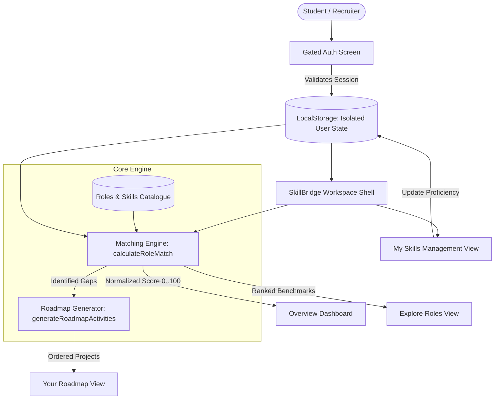

# SkillBridge — Student Skill-to-Role Matching Workspace

> An interactive, data-driven skill gap evaluator and structured career roadmap generator for Computer Science & Engineering (CSE) students.

[](https://www.typescriptlang.org/)
[](https://react.dev/)
[](https://tailwindcss.com/)
[](https://vitest.dev/)
[](https://opensource.org/licenses/MIT)

---

## 🎯 Problem Statement

Early-career engineering students and graduates often struggle to bridge the gap between academic coursework and real-world tech industry expectations:

1. **Vague Job Descriptions**: Postings contain buzzword-heavy requirements that make it hard to tell what skills are strictly necessary versus "nice-to-have".
2. **Ambiguous Proficiency**: Students don't know where their self-taught or university knowledge lands relative to entry-level industry expectations.
3. **Action Paralysis**: After realizing a skill gap, students often lack an actionable, project-based curriculum to systematically close it.

**SkillBridge** solves this with a deterministic, local-first evaluation workspace. It compares current proficiencies against curated industry benchmarks, calculates normalized match scores with clear explanations, and generates ordered project-based learning roadmaps.

---

## ✨ Key Features

- **📊 Data-Driven Overview Workspace**:
  - Live metric snapshots: Best role match %, target goal gaps, and roadmap completion momentum.
  - Ranked role cards dynamically ordered by match percentage.
  - "Strongest Opportunities" highlighting top skill gaps with one-click transitions to skill rating.
  - Immediate preview of upcoming practical learning milestones.

- **🧭 Explore Roles Workspace**:
  - Curated, realistic engineering benchmarks: Frontend Developer, Full-Stack Developer, UI Engineer, Backend Developer.
  - Real-time search across role title, engineering team, work style, and technical requirements.
  - Filter pills by engineering discipline (_All_, _Frontend_, _Full-Stack_, _Backend_).
  - One-click target goal selection immediately updating metrics across all views.

- **🔐 Gated Authentication & User Isolation**:
  - Client-side authentication module (`src/lib/auth.ts`) utilizing Web Crypto SHA-256 password hashing.
  - Multi-user data isolation: separate student accounts have independent skill levels, goals, and roadmaps.
  - Pre-seeded demo account for 1-click recruiter evaluation (`alex.chen@student.edu` / `Password123!`).

- **🎛️ My Skills Workspace & Skill Management**:
  - Categorized CSE technical skills across _Frontend_, _Tools & practices_, and _Backend_.
  - Standardized 4-tier proficiency model:
    - `0 — Not yet (Beginner)`: No exposure or fundamentals only.
    - `1 — Learning (Developing)`: Understands concepts; completes guided tutorials.
    - `2 — Comfortable (Intermediate)`: Builds independently; resolves typical bugs.
    - `3 — Confident (Advanced)`: Deep architectural grasp; writes clean tests.
  - **Custom Skill Creator**: Add arbitrary engineering skills and categories.
  - **Extended Catalogue Modal**: Choose from optional skills (Tailwind, Next.js, Docker, Python, PostgreSQL, GraphQL).

- **🗺️ Personalized Learning Roadmap**:
  - Dynamically generated activities specifically targeting the student's gaps for their selected target role.
  - Detailed task breakdown: estimated duration, core learning objectives, practical exercise instructions, and documentation links.
  - Step-by-step modal guide for hands-on portfolio implementation.
  - Interactive completion tracking with progress bars.

- **💾 SSR-Safe Local Persistence**:
  - User state persisted in browser `localStorage` with versioned migrations (`v2`).
  - Zero hydration flash or layout shift during server-side rendering.

---

## 🏛️ System Architecture & Data Flow



---

## 🧮 Matching Engine Formula

The match scoring algorithm (`src/lib/matching.ts`) is deterministic, transparent, and educational:

$$\text{Score} = \text{round}\left( \frac{\sum_{i=1}^{N} \min\left(\text{CurrentLevel}_i, \text{RequiredLevel}_i\right) / \text{RequiredLevel}_i}{N} \times 100 \right)$$

- **Equal Weighting**: Every requirement in a role contributes $1/N$ of the total score.
- **Proportional Credit**: Partial proficiency earns proportional credit (e.g. Level 1 toward a Level 2 requirement gives 50% credit for that skill).
- **Safety**: Robust against empty requirement sets, missing catalog entries, and out-of-range user input.

---

## 🛠️ Technology Stack

| Layer                      | Technology                                                                                    | Purpose                                                        |
| :------------------------- | :-------------------------------------------------------------------------------------------- | :------------------------------------------------------------- |
| **Framework**              | [TanStack Start](https://tanstack.com/start) + [TanStack Router](https://tanstack.com/router) | Full-stack React SSR & type-safe client routing                |
| **Language**               | [TypeScript 5.8](https://www.typescriptlang.org/)                                             | Strict type checking, interfaces, and discriminated unions     |
| **UI Library**             | [React 19](https://react.dev/)                                                                | Component architecture, custom hooks, and state management     |
| **Styling**                | [Tailwind CSS v4](https://tailwindcss.com/)                                                   | Modern utility styling with OKLCH CSS variable design tokens   |
| **Icons**                  | [Lucide React](https://lucide.dev/)                                                           | Accessible, consistent iconography                             |
| **Primitives**             | [Radix UI](https://www.radix-ui.com/)                                                         | Accessible dialogs, alert confirmations, and modal focus traps |
| **Testing**                | [Vitest 4](https://vitest.dev/) + React Testing Library                                       | Deterministic unit and integration test suites (44 tests)      |
| **Linting & Code Quality** | ESLint 9 + Prettier                                                                           | Style guide compliance and code formatting                     |

---

## 📸 Screenshots

|                   Overview Dashboard                    |                       Explore Roles                        |
| :-----------------------------------------------------: | :--------------------------------------------------------: |
|  | _Role exploration with live search and category filtering_ |

|               My Skills Matrix                |                 Personalized Roadmap                 |
| :-------------------------------------------: | :--------------------------------------------------: |
| _Interactive 4-tier skill proficiency rating_ | _Targeted project exercises and step-by-step guides_ |

---

## 🚀 Installation & Local Setup

### Prerequisites

- **Node.js**: `v20.0.0` or higher (tested on `v26.8.1`)
- **npm**: `v10.0.0` or higher

### Steps

1. **Clone the repository**:

   ```bash
   git clone https://github.com/kabhi-25/skillbridge.git
   cd skillbridge
   ```

2. **Install dependencies**:

   ```bash
   npm install
   ```

3. **Configure environment variables**:

   ```bash
   cp .env.example .env
   ```

4. **Start the development server**:

   ```bash
   npm run dev
   ```

   Open `http://localhost:8080` (or `http://localhost:5173`) in your browser.

5. **Demo Quick-Login**:
   - On the login screen, click **"Auto-fill credentials"** to populate the pre-seeded account:
     - **Email**: `alex.chen@student.edu`
     - **Password**: `Password123!`

---

## 🧪 Testing & Verification

Run the automated test suite covering authentication, algorithms, persistence, and UI flows:

```bash
# Run all unit and integration tests (44 tests)
npm test

# Run ESLint check
npm run lint

# Format code with Prettier
npm run format

# Production build test
npm run build
```

---

## 💡 Engineering Challenges & Solutions

### 1. SSR Hydration Mismatches with Dynamic Local Storage

- **Challenge**: Reading browser `localStorage` on initial server-side render causes hydration mismatches or layout shifts.
- **Solution**: Implemented an SSR-safe container check (`isClientReady` flag) combined with versioned sanitization (`src/lib/storage.ts`) so the initial HTML matches exactly, then hydrates smoothly on the client.

### 2. Multi-Account Data Isolation Without a Remote Backend

- **Challenge**: Demonstrating login/registration workflows for recruiters without standing up an external database.
- **Solution**: Built an isolated client authentication service using the Web Crypto API (`crypto.subtle.digest("SHA-256")`) with dynamic per-user salt generation. Each student's progress is saved under an isolated key (`skillbridge_student_state_v2_{userId}`), preventing data cross-contamination between accounts.

### 3. Transparent, Deterministic Matching Algorithm

- **Challenge**: Many matching systems use opaque black-box scoring that confuses students about what to study.
- **Solution**: Created a fully transparent mathematical formula that gives proportional credit for partial competencies and generates plain-English explanations showing met, in-progress, and unstarted skills.

---

## 🔮 Future Improvements

- [ ] **Cloud Backend Integration**: Optional sync to Supabase / PostgreSQL with OAuth 2.0 (GitHub / Google login).
- [ ] **Resume / Portfolio Export**: Generate downloadable PDF and Markdown reports of completed roadmap projects.
- [ ] **Custom Role Builder**: Allow students or professors to paste job descriptions or syllabus requirements to create custom role benchmarks.
- [ ] **GitHub REST API Verification**: Automatically verify completed roadmap projects by checking public GitHub repository commits.

---

## 👤 Author & Contact

**Abhishek (kabhi-25)**

- **GitHub**: [@kabhi-25](https://github.com/kabhi-25)
- **Repository**: [https://github.com/kabhi-25/skillbridge](https://github.com/kabhi-25/skillbridge)
- **LinkedIn**: [Connect on LinkedIn](https://www.linkedin.com)

---

## 📄 License

This project is licensed under the [MIT License](LICENSE).
